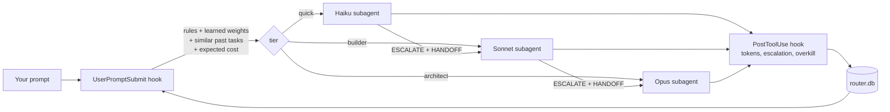

# claude-autorouter

**Cost-aware, self-learning model routing for Claude Code.**
Every prompt is routed to Haiku, Sonnet or Opus based on its complexity. When a cheap tier is not enough, it escalates without starting over, and the router learns from it. Built for Pro/Max subscriptions: no proxy, no API key, standard library only.

```
you: "where is the auth middleware?"        -> quick     (Haiku)
you: "add a /health endpoint"               -> builder   (Sonnet)
you: "why does the app crash randomly?"     -> architect (Opus)
```

## Why

Running everything on Opus burns your usage limit; running everything on Sonnet fails on the hard problems. Picking a model by hand for every prompt does not scale. Claude Code cannot switch the main session's model per prompt, but it can delegate to subagents that each pin their own model. This project makes that delegation automatic, measures what it costs, and gets better with use.

## How it works



1. **Route.** A `UserPromptSubmit` hook scores the prompt (English and French rules), adds learned per-word weights, looks up similar past tasks, and injects one short line telling the main session (Sonnet, the orchestrator) which subagent to delegate to. Follow-ups such as "ok go ahead" are not routed.
2. **Escalate.** Subagents that hit something beyond their tier stop and answer `ESCALATE:` with a `HANDOFF` block (files read, facts found, hypotheses ruled out). The orchestrator re-delegates one tier up, and the next tier starts from the hand-off instead of re-exploring.
3. **Measure.** A `PostToolUse` hook records each delegated run (tokens, tool calls, escalation). A `Stop` hook adds the main session's own token usage for the turn, read from the transcript.
4. **Learn.** Three mechanisms, all local:
   - **Nearest neighbours:** TF-IDF similarity over past tasks. If similar tasks kept escalating from `quick`, similar new ones start at `builder`.
   - **Per-word weights:** escalations push the words of a prompt towards harder tiers; *overkill* (a task finished in a couple of tool calls on a tier above what it needed) pulls them down. User overrides (`!architect ...`) teach too.
   - **Expected cost:** for each candidate tier, `cost(t) + P(escalate | t) × (cost(next) + penalty)`, with costs measured on your own runs. The cheapest tier wins.

### Guard rails

Learning only from escalations would ratchet everything up to Opus, so the router is deliberately conservative:

- It learns in **both directions**: escalations raise, overkill lowers.
- The cost model moves **at most one tier** away from the rules, and **only with evidence** from similar past tasks (successes one tier below, or escalations at the rules' tier). It never bets on a double escalation.
- Learned weights need **3 observations** before they count, are clipped, and **decay** (30-day half-life).
- A **daily Opus cap** (30% of tasks by default) routes to `builder` instead and asks before using `architect`, unless the prompt has strong signals.
- Rule changes are **never applied automatically**: `/router-learn` proposes regex patterns as a diff and waits for your approval.

### Token savings beyond model choice

- **Terse subagent reports.** A subagent's report stays in the orchestrator's context for every later turn, so reports have a hard word budget (60 / 150 / 250 words) and a fixed, filler-free format.
- **No duplicated exploration.** Escalations carry a `HANDOFF` block, so the next tier does not re-read the same files.
- **Small, stable injected context.** One line (about 30 tokens) with a constant prefix, so it plays well with prompt caching.
- **Follow-ups are not delegated**, because spawning a subagent costs a cold start.
- **Optional context hygiene** (`--hygiene`): denies reads of lockfiles, `node_modules`, build output and minified bundles.

## Install

Requires Claude Code and Python 3.9+. Works on macOS, Linux and Windows.

```bash
git clone https://github.com/ExLuna-rs/claude-autorouter.git
cd claude-autorouter
python3 install.py            # add --hygiene to block reads of bulky files
```

On Windows (PowerShell), run the installer with `py install.py` (or `python install.py`).

The hooks are pinned to the Python interpreter that ran the installer, written as an absolute path, so they work whether your shell knows `python3`, `python` or `py`. If you later remove that interpreter (a deleted venv, for example), run the installer again.

The installer copies three agents and two commands into `~/.claude/`, installs the router in `~/.claude/autorouter/`, and registers three hooks in `~/.claude/settings.json` (a backup is saved as `settings.json.bak`). It is idempotent, so run it again to upgrade. It also:

- sets the main session model to `sonnet` if you have not set one (Sonnet is the orchestrator);
- removes `CLAUDE_CODE_SUBAGENT_MODEL` from the settings, because it overrides per-agent models.

Restart Claude Code and check with `/agents`.

## Usage

Nothing to do: every prompt is routed. To see why a prompt goes where it goes:

```bash
python3 ~/.claude/autorouter/run.py explain "migrate the auth module to OAuth"
# Windows: py $HOME\.claude\autorouter\run.py explain "migrate the auth module to OAuth"
```

Force a tier by starting a prompt with a prefix. The router also learns from these corrections:

| Prefix       | Tier                                   |
|--------------|----------------------------------------|
| `!quick`     | Haiku                                  |
| `!builder`   | Sonnet                                 |
| `!architect` | Opus                                   |
| `!direct`    | no delegation, the main session answers |

Slash commands:

- **`/router-stats`**: tasks per tier, escalation and overkill rates, cost per task and its trend, savings against the same tokens on Opus, and learned words.
- **`/router-learn`**: reviews recent misroutes and proposes new patterns for `config.json`, which you approve before they are applied.

## Configuration

Optional, in `~/.claude/autorouter/config.json`. Every key is optional; see `autorouter/config.py` for the full list.

```json
{
  "opus_daily_cap": 0.25,
  "store_prompt_chars": 0,
  "projects": {
    "~/code/licence-server": { "min_tier": "builder" }
  },
  "extra_strong": ["\\bterraform state\\b"],
  "extra_quick": ["^\\s*explain\\b"]
}
```

Patterns are Python regexes matched against the prompt lower-cased with accents removed.

## Data and privacy

Everything stays local, in `~/.claude/autorouter/router.db` (SQLite). For each task the router stores its content words, the first 200 characters of the prompt (set `store_prompt_chars` to `0` to store none), the tiers involved and token counts. Nothing is sent anywhere.

```bash
python3 ~/.claude/autorouter/run.py reset --weights --yes   # forget learned weights
python3 ~/.claude/autorouter/run.py reset --all --yes       # forget everything
```

## Limitations

- **Delegation, not switching.** Hooks cannot change the main session's model, so the router tells the orchestrator which subagent to use. Models follow this reliably, but it is not a hard guarantee.
- **Keyword rules to start.** Until it has data, the router relies on rules that will sometimes misjudge a prompt. Prefixes and `/router-learn` exist for that.
- **Approximate costs.** Costs are weighted tokens (input 1, cache write 1.25, cache read 0.1, output 5, multiplied by 1/3/5 for Haiku/Sonnet/Opus). They are meant for comparing tiers, not for computing a bill. Older Claude Code versions report only total tokens for subagents, which makes the estimate rougher.
- **Opus spends a Pro quota fast.** Keep an eye on `/usage` while the router calibrates.

## Uninstall

```bash
python3 install.py --uninstall   # keeps learned data; delete ~/.claude/autorouter to erase it
```

## Development

```bash
python3 -m unittest discover -s tests
```

## Related projects

- [tzachbon/claude-model-router-hook](https://github.com/tzachbon/claude-model-router-hook), [misterkante/cc-model-router](https://github.com/misterkante/cc-model-router), [IuriiTurok/auto-model-router](https://github.com/IuriiTurok/auto-model-router): hook-based tier routing for Claude Code.
- [musistudio/claude-code-router](https://github.com/musistudio/claude-code-router): a proxy that routes Claude Code requests across providers (API keys).
- Caveman: a skill that makes Claude answer tersely to save output tokens. It is complementary to this project.

## License

MIT
